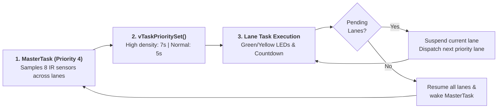

# Intelligent Real-Time Traffic Signal System using FreeRTOS

> **Publication:** Published in **IEEE Xplore** (08/2025) — [Direct IEEE Document Link](https://ieeexplore.ieee.org/document/11135576)  
> **Core Technologies:** FreeRTOS v10.6.2, Embedded C, ATmega2560 (16 MHz), Cooperative Scheduling, Real-Time Dynamic Priority Allocation  
> **Bench Tools & Debug:** Digilent Analog Discovery 2 USB Logic Analyzer, WaveForms Digital Pattern Generator  
> **Full Engineering Report:** [View Project Report (Project_Report.pdf)](./Project_Report.pdf)  
> **Architecture Flowchart:** [Jump to Flowchart Diagram](#system-execution-flowchart)

---

## Project Overview

Urban traffic congestion in Indian cities causes severe economic losses and air pollution due to inflexible, fixed-timing traffic light controllers. This project designs and implements an **Intelligent Traffic Control System (ITCS)** on an **ATmega2560 (Arduino Mega 2560 @ 16 MHz)** running **FreeRTOS**.

The system dynamically detects vehicle density across 4 lanes using high/low IR sensor pairs and automatically reconfigures signal timings and **task execution priorities in real-time** using FreeRTOS scheduling APIs.

---

## Hardware & Software Architecture

### Hardware Components:
- **Microcontroller:** Arduino Mega 2560 (ATmega2560 @ 16 MHz, 256 KB Flash, 8 KB SRAM, 54 Digital I/O pins).
- **Sensors:** 8 IR Proximity Sensors (2 per lane: High-Density `H` and Low-Density `L`).
- **Actuators:** 12 Traffic LEDs (Red, Yellow, Green for Lanes 1–4) + 7-Segment Countdown Display.
- **Test & Validation Instrument:** **Digilent Analog Discovery 2 Kit** (USB Oscilloscope & Logic Analyzer via WaveForms software).

### Software Architecture:
- **Operating System:** FreeRTOS v10.6.2.
- **Scheduling Model:** Cooperative & Priority-driven task management (`configUSE_PREEMPTION = 0`, `configMAX_PRIORITIES = 6`).

---

## FreeRTOS Task Structure & Priority Allocation

### Dynamic Scheduling Flow

---

## Firmware Architecture & Low-Level Design

From a firmware architecture and real-time systems design standpoint:

- **SRAM Stack Allocation & Budgeting:**
  - The target ATmega2560 provides 8 KB of SRAM. To prevent stack overflow and collisions with static BSS variables, task stack sizes are strictly constrained: 150 words allocated to `MasterTask` and 100 words to each of the 4 lane actuation tasks.
  - Total kernel task footprint remains under 1.5 KB, preserving memory bandwidth and ensuring zero out-of-memory kernel panics.

- **Deterministic Cooperative Scheduling (`configUSE_PREEMPTION = 0`):**
  - Non-preemptive scheduling eliminates race conditions on shared GPIO port registers (`PORTA`, `PORTC`) and display drivers without requiring priority inheritance mutexes or critical sections.
  - Context switches occur deterministically at explicit yield points (`vTaskSuspend` and `taskYIELD`), ensuring jitter-free countdown timing.

- **Runtime Dynamic Priority Mutation:**
  - Leverages FreeRTOS `vTaskPrioritySet()` directly within `MasterTask` to dynamically re-order scheduler ready queues in real-time based on debounced IR sensor digital reads.

- **Hardware-Synchronized Non-Blocking Timekeeping:**
  - Uses FreeRTOS tick counters (`xTaskGetTickCount()`) for 1-second interval delta comparisons, maintaining synchronization with the hardware timer interrupt without CPU busy-wait spinlocks.

---

## Experimental Validation (Analog Discovery 2)

The system was physically probed and validated using the **Digilent Analog Discovery 2 USB Logic Analyzer**:
- **High-Density Lane (H=1, L=1):** Measured green signal active duration = **9.07 seconds**.
- **Low-Density Lane (H=1, L=0):** Measured green signal active duration = **7.3 seconds**.
- Verified zero task deadlocks and exact priority scheduling through WaveForms digital pattern generator and logic analyzer channels.

---

## Source Code & Documentation

- [src/Traffic_Controller_4Lane.ino](./src/Traffic_Controller_4Lane.ino): Complete, verified 4-lane adaptive traffic signal firmware.
- [Project_Report.pdf](./Project_Report.pdf): Complete 41-page engineering project architecture and validation report.
- [Project_Presentation.pptx](./Project_Presentation.pptx): Project defense presentation slide deck.
