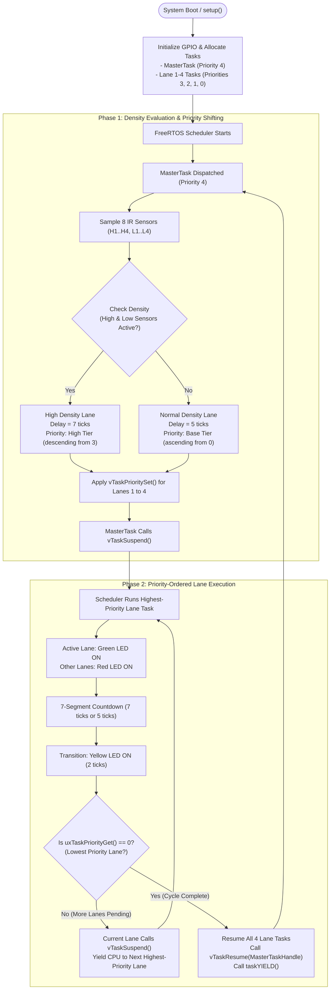

# Intelligent Real-Time Traffic Signal System using FreeRTOS

[](https://ieeexplore.ieee.org/document/11135576)
[]()
[]()
[]()
[]()

> **Peer-Reviewed Research:** Published in **IEEE Xplore** (08/2025).  
> **Course:** 6EC191 Minor Project Report, Department of Electronics & Communication Engineering, Nirma University.  
> **Author:** Divyani Patel (23MRE005)  
> **Direct IEEE Link:** [https://ieeexplore.ieee.org/document/11135576](https://ieeexplore.ieee.org/document/11135576)  
> **Full PDF Report:** [View Technical Report (Project_Report.pdf)](./Project_Report.pdf)  
> **Task Execution Flowchart:** [Jump to Flowchart Diagram](#system-execution-flowchart)

---

## 🚦 Project Overview

Urban traffic congestion in Indian cities causes severe economic losses and air pollution due to inflexible, fixed-timing traffic light controllers. This project designs and implements an **Intelligent Traffic Control System (ITCS)** on an **ATmega2560 (Arduino Mega 2560 @ 16 MHz)** running **FreeRTOS**.

The system dynamically detects vehicle density across 4 lanes using high/low IR sensor pairs and automatically reconfigures signal timings and **task execution priorities in real-time** using FreeRTOS scheduling APIs.

---

## 🛠️ Hardware & Software Architecture

### Hardware Components:
- **Microcontroller:** Arduino Mega 2560 (ATmega2560 @ 16 MHz, 256 KB Flash, 8 KB SRAM, 54 Digital I/O pins).
- **Sensors:** 8 IR Proximity Sensors (2 per lane: High-Density `H` and Low-Density `L`).
- **Actuators:** 12 Traffic LEDs (Red, Yellow, Green for Lanes 1–4) + 7-Segment Countdown Display.
- **Test & Validation Instrument:** **Digilent Analog Discovery 2 Kit** (USB Oscilloscope & Logic Analyzer via WaveForms software).

### Software Architecture:
- **Operating System:** FreeRTOS v10.6.2.
- **Scheduling Model:** Cooperative & Priority-driven task management (`configUSE_PREEMPTION = 0`, `configMAX_PRIORITIES = 6`).

---

## ⚙️ FreeRTOS Task Structure & Priority Allocation

<a id="system-execution-flowchart"></a>
### 📊 System Execution Flowchart



---

### 📋 Step-by-Step Architecture & Execution Flow

1. **Step 1: System Boot & Task Creation (`setup()`)**
   - Configures 8 IR digital inputs (`Sensor1_1` through `Sensor4_2`) and 12 traffic LEDs (`R1..R4`, `Y1..Y4`, `G1..G4`).
   - Configures 7 output pins for the 7-segment countdown display.
   - Spawns 5 FreeRTOS tasks:
     - `MasterTask_Sensor` (Priority: 4, Stack: 150 words)
     - `taskLane1` to `taskLane4` (Initial Priorities: 3, 2, 1, 0, Stack: 100 words each).
   - Configured with non-preemptive cooperative scheduling (`configUSE_PREEMPTION = 0`).

2. **Step 2: Real-Time IR Sensing & Dynamic Priority Sorting (`MasterTask`)**
   - `MasterTask` samples the High (`H`) and Low (`L`) IR sensors for all 4 lanes simultaneously.
   - Evaluates boolean density: `local_Assignment[lane] = (H & L)`.
   - **High Density (`H=1, L=1`):** Vehicles queued across both sensors.
     - Green interval set to **7 ticks** (`Delay_Tick_Array[k] = 7`).
     - Priority assigned from highest available tier (e.g., Priority 3, 2).
   - **Normal Density:**
     - Green interval set to **5 ticks** (`Delay_Tick_Array[k] = 5`).
     - Priority assigned from lower tier (e.g., Priority 0, 1).
   - Calls `vTaskPrioritySet()` in real time for `taskLane1Handle` through `taskLane4Handle`.
   - `MasterTask` calls `vTaskSuspend(MasterTaskHandle)` to yield CPU control.

3. **Step 3: Sequential Priority-Driven Lane Execution**
   - The FreeRTOS scheduler selects the ready task with the highest priority.
   - Actuates **Green LED** on the current lane while keeping **Red LEDs** on all other three lanes.
   - Counts down green signal ticks (7s or 5s) on the 7-segment display using `xTaskGetTickCount()`.
   - Transitions to **Yellow LED** for 2 ticks before closing the lane.

4. **Step 4: Non-Preemptive Handoff (`uxTaskPriorityGet() > 0`)**
   - Upon completing yellow warning, the lane checks its own priority:
     ```c
     check = uxTaskPriorityGet(taskLaneHandle);
     ```
   - If `check != 0` (other lower-priority lanes are still waiting to run):
     - Calls `vTaskSuspend(taskLaneHandle)`.
     - Scheduler automatically hands CPU control to the next highest priority ready lane.

5. **Step 5: Cycle Wrap & Next Epoch Trigger (`uxTaskPriorityGet() == 0`)**
   - When the lowest priority task (`check == 0`) completes its cycle:
     - It awakens all 4 lane tasks: `vTaskResume(taskLane1Handle)...vTaskResume(taskLane4Handle)`.
     - Awakens Master Task: `vTaskResume(MasterTaskHandle)`.
     - Calls `taskYIELD()` to hand control back to `MasterTask`.
   - `MasterTask` (Priority 4) immediately preempts/runs, reads fresh sensor data, recalculates priorities, and starts the next adaptive cycle.

---

## 🔬 Experimental Validation (Analog Discovery 2)

The system was physically probed and validated using the **Digilent Analog Discovery 2 USB Logic Analyzer**:
- **High-Density Lane (H=1, L=1):** Measured green signal active duration = **9.07 seconds**.
- **Low-Density Lane (H=1, L=0):** Measured green signal active duration = **7.3 seconds**.
- Verified zero task deadlocks and exact priority scheduling through WaveForms digital pattern generator and logic analyzer channels.

---

## 📂 Source Code

- [src/Traffic_Controller_4Lane.ino](./src/Traffic_Controller_4Lane.ino): Complete, verified 4-lane adaptive traffic signal firmware from thesis Appendix.
- [Project_Report.pdf](./Project_Report.pdf): Full 41-page thesis report.
