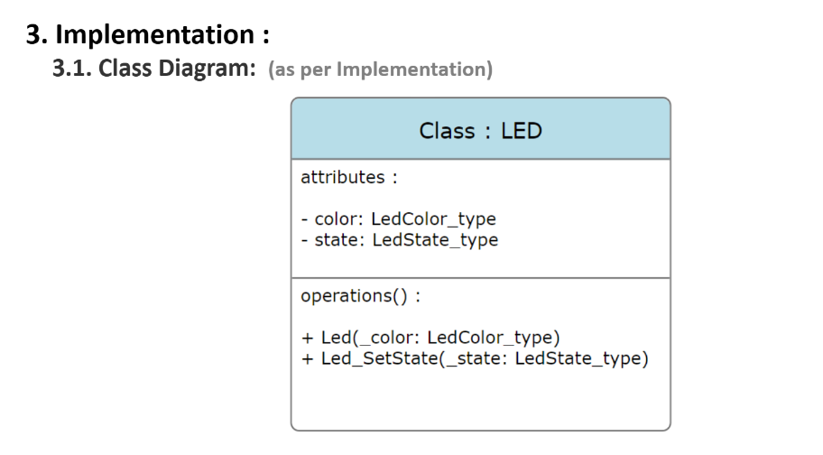

# Embedded C++ Hardware Abstraction & Peripheral Driver

> **Core Technologies:** Embedded C++, ARM Cortex-M3 (STM32F103C8T6), Object-Oriented Firmware Design, Direct Register Manipulation  
> **Bench Tools & Debug:** Keil uVision MDK-ARM v5, ST-Link V2, Breadboard Hardware Bench  
> **Technical Documentation:** [View Architecture Report (Project_Report.pdf)](./Project_Report.pdf)

---

## Project Overview

This project demonstrates the implementation of Object-Oriented Programming (OOP) concepts in bare-metal embedded firmware on an **ARM Cortex-M3 microcontroller (STM32F103C8T6)**. 

By applying data encapsulation and abstraction directly over memory-mapped hardware registers, the design decouples peripheral control logic from application code without incurring runtime performance or memory overhead.

---

## Class Architecture & Hardware Model

- **Data Encapsulation:** Hardware pin state and configuration masks are maintained as private class members (`color`, `state`), preventing direct external tampering.
- **Unified Public Interface:** The application interacts solely through strict public methods (`Led_SetState`), ensuring type-safe peripheral operation.

---

## Firmware Architecture & Low-Level Design

From a firmware engineering and low-level peripheral driver standpoint:

- **Direct Memory-Mapped Register Access:**
  - Configures peripheral bus clock gating via `RCC_APB2ENR` (`RCC_BASE + 0x18`, bit 4 `IOPCEN`) during class instantiation.
  - Controls GPIO configuration and pin mode through Port Configuration Register High (`GPIOC_CRH` at `0x40011004`), setting output mode to push-pull (2 MHz).
  - Directly drives and clears pin states via Port Output Data Register (`GPIOC_ODR` at `0x4001100C`).

- **Deterministic Constructor Initialization:**
  - The constructor executes peripheral clock enablement and port direction programming based on the passed color enum, guaranteeing hardware is ready before method calls occur.

- **Zero-Cost Abstraction Principles:**
  - Member functions operate directly on volatile register pointers without virtual table (vtable) dispatch, avoiding dynamic dispatch overhead and dynamic memory allocation (`malloc`/`new`).

---

## Hardware Bench Verification

- **Target Hardware:** STM32F103C8T6 Blue Pill board running at 72 MHz.
- **Actuators:** Multi-channel LEDs (PC13, PC14, PC15) wired in active-low sink configuration.
- **Validation:** Compiled via Keil MDK-ARM v5 and flashed via ST-Link V2. Verified deterministic state transitions, correct bitmask register operations, and clean scoping across independent class instances.

---

## Technical Documentation

- [Project_Report.pdf](./Project_Report.pdf): Engineering design report detailing register mapping, class diagrams, and bench results.
