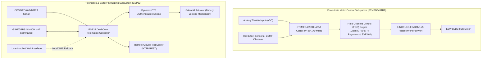

# Electric Two-Wheeler BLDC Motor Controller & IoT Telematics System

> **Role:** Embedded Software & Firmware Developer (Industry Engineering Project)  
> **Core Technologies:** Field-Oriented Control (FOC), ARM Cortex-M4 (STM32G431RB), 3-Phase Inverter Driving, ESP32, GSM/GPRS (SIM800L), GPS (NEO-6M), Cellular Telematics  
> **Firmware Toolchains & Debug:** STM32CubeIDE, STM32 Motor Control Workbench, Motor Profiler, ST-Link V2, Digital Storage Oscilloscope (DSO), Logic Analyzer  
> **Technical Documentation:** [View Full Engineering Report (Project_Report.pdf)](./Project_Report.pdf)

---

## Project Overview

This project presents the firmware architecture, implementation, and vehicle-level validation of an integrated powertrain motor control and telematics subsystem for Electric Two-Wheeler (E2W) applications. 

As the **Embedded Software Developer**, the primary responsibility was architecting and implementing the real-time embedded software across two microcontrollers:
1. **STM32G431RB (ARM Cortex-M4 @ 170 MHz):** Real-time Field-Oriented Control (FOC) motor driver firmware, timer PWM generation, ADC throttle sampling, and cruise control state machine.
2. **ESP32 Dual-Core SoC:** Cellular telematics middleware, GPS NMEA parsing, and dual-mode (cloud/local web server) battery swapping authentication logic.

---

## System Architecture

---

## Embedded Software & Firmware Architecture

### 1. Motor Control Firmware (STM32G431RB)

The motor control firmware executes high-frequency real-time vector control loops tightly synchronized with the advanced motor control timer (`TIM1`) and multi-channel ADCs:

- **Field-Oriented Control (FOC) Mathematical Pipeline:**
  - **Vector Transformations:** Implements Clarke transformation to convert 3-phase stator currents ($I_a, I_b, I_c$) into two-phase stationary coordinates ($I_\alpha, I_\beta$), followed by Park transformation to rotate coordinates into the rotor reference frame ($I_d, I_q$).
  - **Decoupled Current Regulation:** Runs dual discrete PI controllers. Quadrature current ($I_q$) directly regulates electromagnetic torque according to throttle demand, while direct current ($I_d$) is driven to zero to minimize reactive stator flux and achieve optimal torque-per-ampere efficiency.
  - **Space Vector PWM (SVPWM) Modulation:** Calculates instantaneous voltage sector assignments and duty cycles across complementary high-side/low-side timer channels with configurable dead-time insertion.

- **Hybrid Commutation State Engine:**
  - **Low-Speed / Startup Commutation:** Processes 120-degree Hall sensor inputs via input capture timers to provide deterministic rotor position estimates during standstill launch and high-load acceleration.
  - **High-Speed Sensorless Transition:** Incorporates a Back-EMF (BEMF) state observer in the rotating reference frame at medium-to-high speeds, allowing seamless transition to sensorless operation.

- **Throttle Acquisition & Cruise Control State Machine:**
  - Multi-sample ADC acquisition with moving-average digital low-pass filtering and deadband rejection to eliminate throttle jitter.
  - Non-blocking cruise control state machine managing states (`IDLE`, `ACTIVE`, `OVERRIDE`):
    - Engaged via external push-button interrupt.
    - Continuously cross-checks speed setpoint against motor feedback.
    - Incorporates hard real-time brake interrupt triggers that instantly disengage cruise mode and de-assert motor drive signals for safety.

---

### 2. Telematics & Security Firmware (ESP32)

The telematics firmware runs as an independent concurrent system handling cloud telematics, positioning, and access control:

- **Cellular & Satellite Driver Architecture:**
  - **GPS NMEA Stream Decoder:** Hardware UART interrupt routine parsing standard NMEA sentences (`$GPRMC`, `$GPGGA`) to extract vehicle latitude, longitude, speed over ground, and fix status.
  - **GSM/GPRS Modem State Machine:** Non-blocking serial AT command parser interfacing with the SIM800L module to handle network registration, GPRS bearer activation, and HTTP POST transactions.

- **Dual-Mode Dynamic Authentication Logic:**
  - **Primary Online Verification:** Receives authenticated dynamic OTP passkeys from the central fleet server via cellular HTTP API.
  - **Offline Captive Fallback:** When cellular signal is lost, the firmware dynamically switches the ESP32 Wi-Fi into SoftAP mode, serving a lightweight captive HTML configuration page where the technician or user enters the authenticated passkey locally.
  - **Anti-Brute Force Protection:** Implements an authentication state machine enforcing a maximum of 3 failed attempts within a 30-second window before locking out access and driving a high-torque solenoid latch to secure the swappable battery enclosure.

---

## Hardware Bench Verification & On-Vehicle Validation

- **Motor Parameter Extraction & Tuning:**
  - Extracted stator electrical parameters (phase resistance $R_s$, inductance $L_s$, back-EMF constant $K_e$, pole pairs $pp$) using the STM32 Motor Profiler.
  - Calibrated PI controller proportional ($K_p$) and integral ($K_i$) gains using STM32 Motor Control Workbench.

- **Oscilloscope & Logic Analyzer Bench Validation:**
  - Verified 3-phase SVPWM switching waveforms, phase current alignment, and dead-time margins on the X-NUCLEO-IHM16M1 inverter bridge.
  - Validated AT command timeout resilience, GPS lock acquisition times, and solenoid actuation pulses.

- **Vehicle Integration:**
  - Integrated and validated on a physical electric two-wheeler prototype, achieving responsive acceleration, smooth cruise maintenance, immediate brake cutoff, and reliable swappable battery locking.

---

## Technical Documentation

- [Project_Report.pdf](./Project_Report.pdf): Complete 32-page engineering design report detailing mathematical derivations, hardware schematics, firmware flowcharts, and experimental bench results.
