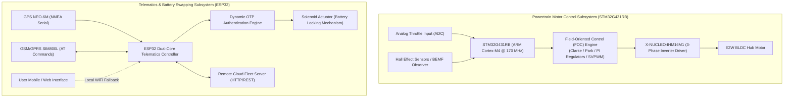

# Electric Two-Wheeler BLDC Motor Controller & IoT Telematics System

> **Core Technologies:** Field-Oriented Control (FOC), ARM Cortex-M4 (STM32G431RB), 3-Phase Inverter Driving, ESP32, GSM/GPRS (SIM800L), GPS (NEO-6M), Cellular Telematics  
> **Bench Tools & Toolchains:** STM32 Motor Control Workbench, Motor Profiler, STM32CubeIDE, Logic Analyzer, Digital Storage Oscilloscope (DSO)  
> **Technical Documentation:** [View Full Engineering Report (Project_Report.pdf)](./Project_Report.pdf)

---

## Project Overview

This project presents the design, implementation, and vehicle-level validation of an integrated powertrain motor controller and telematics subsystem for Electric Two-Wheeler (E2W) applications. 

The system couples a high-performance **STM32G431RB** ARM Cortex-M4 microcontroller running **Field-Oriented Control (FOC)** for permanent magnet synchronous / brushless DC (BLDC) motor actuation with an **ESP32-based cellular telematics and security unit** providing real-time fleet GPS tracking and an authenticated, fail-safe battery swapping lock mechanism.

---

## System Architecture

---

## Core Engineering Subsystems

### 1. FOC BLDC Motor Controller Driver

The powertrain driver leverages the advanced math and motor-control peripherals of the STM32G431RB (CORDIC math accelerator, high-resolution timers, embedded analog comparators, and operational amplifiers):

- **Field-Oriented Control (FOC) Pipeline:**
  - **Clarke & Park Transformations:** Converts three-phase stator currents ($I_a, I_b, I_c$) measured by shunt resistors into stationary orthogonal coordinates ($\alpha, \beta$), then projects them onto the rotating rotor flux reference frame ($d, q$).
  - **Decoupled Torque and Flux Regulation:** Employs dual cascaded proportional-integral (PI) controllers to independently regulate the quadrature current ($I_q$, directly proportional to motor torque) and direct current ($I_d$, flux component maintained at zero for maximum torque-per-ampere below base speed).
  - **Space Vector Pulse Width Modulation (SVPWM):** Synthesizes optimized switching patterns for the inverter bridge, maximizing DC bus voltage utilization while minimizing harmonic distortion and acoustic noise.

- **Hybrid Commutation Strategy:**
  - **Hall Sensor Mode:** Uses 120-degree hall-effect sensors to resolve unambiguous rotor position during startup and high-load low-speed maneuvers.
  - **Sensorless BEMF Observer Mode:** Transitions to a sliding-mode / back-EMF state observer at higher RPMs, eliminating sensor wiring vulnerability under vibration and thermal stress.

- **Throttle Processing & Cruise Control:**
  - Multi-sample ADC acquisition with moving-average digital filtering for smooth throttle response.
  - State-machine driven cruise control with non-blocking external interrupt detection for set/resume commands and immediate, fail-safe cutoff upon brake actuation.

---

### 2. Cellular Telematics & Swappable Battery Security

To prevent battery theft and enable managed battery swapping infrastructure, an independent telematics and locking unit was developed using the ESP32:

- **Fleet Tracking & Connectivity:**
  - **Position Tracking:** Interfaces with a NEO-6M GPS receiver via hardware UART, parsing NMEA sentences (`$GPRMC`, `$GPGGA`) to stream vehicle coordinates, heading, and velocity.
  - **Cellular Telemetry:** Communicates with a quad-band SIM800L GSM/GPRS module via AT commands over serial, enabling persistent cloud synchronization across urban environments.

- **Dual-Mode Dynamic Authentication Architecture:**
  - **Primary Online Mode:** The user requests a battery swap through the fleet platform. The cloud generates a time-synchronized, single-use dynamic passkey pushed securely to the vehicle over HTTP/GPRS.
  - **Offline Captive Fallback Mode:** In subterranean or remote cellular dead zones, the ESP32 automatically switches to a local Wi-Fi Access Point (AP) mode hosting a lightweight captive web portal. The user inputs their authenticated OTP directly over the local network.
  - **Tamper & Lockout Protection:** The security firmware enforces a strict three-attempt authentication threshold within a 30-second window before engaging an anti-tamper lockout, driving a high-reliability solenoid latch to secure the battery pack.

---

## Hardware Bench Verification & Vehicle Integration

- **Motor Profiling & Parameter Identification:**
  - Utilized the STM32 Motor Profiler to experimentally determine stator resistance ($R_s$), inductance ($L_s$), Back-EMF constant ($K_e$), and motor pole pairs ($pp$).
  - Generated and tuned FOC control loops using STM32 Motor Control Workbench prior to board-level flashing.

- **Bench Testing:**
  - Validated phase current waveforms, gate drive propagation delays, and dead-time insertion on the X-NUCLEO-IHM16M1 inverter stage using a digital storage oscilloscope.
  - Verified cellular HTTP post latency, GPS coordinate lock under dynamic motion, and solenoid engagement timing.

- **On-Vehicle Validation:**
  - Integrated into an operational electric two-wheeler prototype.
  - Validated seamless throttle acceleration, stable cruise maintenance, rapid brake-triggered drive cutoffs, and field-tested swappable battery access workflows.

---

## Technical Documentation

- [Project_Report.pdf](./Project_Report.pdf): Complete 32-page engineering design report detailing mathematical derivations, hardware schematics, firmware flowcharts, and experimental bench results.
